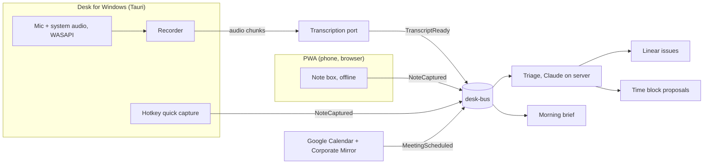

# Desk: Handoff for Claude Code

## Direction (2026-10-29)

Desk is a Sydeso product with a free plan and a paid plan. It combines two jobs:

- **What happened?** Bot-free meeting capture, like anarlog (https://github.com/fastrepl/anarlog). Each meeting has a memo, a transcript, and a summary, linked to its calendar event.
- **What do I do next, and when?** Triage turns notes and meeting action items into Linear issues and proposed time blocks.

Decisions from the user:

1. Triage runs on the server. Notes stay readable to desk-api. There is no end-to-end encryption for now.
2. Meeting recording is in scope. The first platform is Windows.
3. Build path C: Desk stays the planning brain on Cloudflare. The Tauri desktop app captures meetings. Reuse MIT parts of anarlog where they fit, with credit. Never copy from anarlog's `enterprise/` folder.
4. Desk is a product for many people, with free and paid plans.

More decisions (2026-10-30), from the prototype at https://claude.ai/artifact/EbaWCii42jjvcNfuiW5Qes:

5. Desk for Windows is the main client. Its layout follows anarlog: a sidebar with a timeline, tabs, and a note with Memos, Summary, and Transcript.
6. Notes sync between the desktop and the phone, like Obsidian or Simplenote. A note is a document that the user edits on any device. Each device keeps a full local copy and works offline. Changes reach the other devices within seconds. Concurrent edits merge, and no edit is lost.
7. Tasks: a built-in Kanban board for personal tasks, with statuses that the user configures. Work tasks go to project tools through `IssueTrackerPort`: Linear first, then other common tools such as Jira, Asana, ClickUp, and GitHub Issues.
8. Look: the dev.sydeso.com light theme. Geist for all text, ink #141413 on #F7F7F4, and lime #C4FF00 as the accent.




Build Desk. Desk is a personal capture and planning app for one user (Clayton).

The user types unstructured notes into one box. An agent extracts work items, routes each item to the correct Linear project, and proposes calendar time blocks. The user confirms with one tap.

Desk must also:
- Never miss a meeting. Show a morning brief with prep notes.
- Mirror corporate calendar invites into Google Calendar.
- Work offline. Notes are captured in meetings with poor connections.

## Locked decisions

- Multi-tenant from day one (changed on 2026-10-29). One person is one tenant. Each tenant has its own time zone, Linear, Google Calendar, and invite address. The first tenant is Clayton, in America/La_Paz (UTC-04:00).
- Platform: Cloudflare only. The account is paid. Domain: `sydeso.com`.
- Clients: the web app, installed as a PWA on the phone. Desk for Windows, a Tauri app that shows the same web app (changed on 2026-10-29).
- Desk for Windows adds a global hotkey, tray icon, autostart, single instance, and meeting capture (microphone and system audio). Capture is the only logic in the shell. It uploads audio or transcripts to desk-api and keeps no business rules.
- Task system of record: Linear.
- Calendar the agent reads: the user's unified Google calendar. It subscribes to the user's other Google calendars.
- Corporate calendars cannot be subscribed or published (company security). The only way in is forwarded invites. Mirror them to a "Corporate Mirror" Google calendar. The unified calendar subscribes to that calendar.
- The agent writes time blocks to its own "Desk Focus Blocks" Google calendar. The unified calendar subscribes to it.
- LLM: Claude API, called through Cloudflare AI Gateway. Triage runs on the server.
- Transcription sits behind a `TranscriptionPort`. The first adapter is a hosted provider. A local model can come later.
- Plans: free and paid. An Entitlements context decides what each tenant can use. The plan limits are not decided yet.
- Auth (changed on 2026-10-29): Desk owns its accounts in D1. Sign-up is invite only. Sign-in uses a passkey. An email one-time code comes later, when Desk has a mail sender. Cloudflare Access is not used.

## Name and isolation rules

The account has other services. Do not touch them.

Existing resources (do not read, write, or reuse):
- Workers: `sydeso-api`, `sydeso-app`, `sydeso-site`, `sydeso-site-dev`, `sydeso-proposals`, `sydeso`, `personal-site`
- KV: `INBOX`, `dev-INBOX`, `BLOG`, `dev-BLOG`
- R2: `capca-recordings`, `photodrone`, `sydeso-artifacts`, `sydeso-site-media`, `sydeso-site-media-dev`
- D1: none exist

Rules for Desk:
- Prefix every resource with `desk-`. Examples: `desk-api`, `desk-ingest`, `desk-triage`, `desk-events` (D1), `desk-raw` (R2), `desk-bus` (Queue).
- App and API host: `desk.sydeso.com`. Do not use `api.sydeso.com` or `app.sydeso.com`.
- Inbound email host: `in.sydeso.com`. Addresses: `invites@in.sydeso.com` and `notes@in.sydeso.com`.
- Never enable Email Routing on the root domain. It replaces MX records and can stop existing mail.
- Inbound invite addresses are per tenant: `invites+TOKEN@in.sydeso.com`. Each tenant sets its allowed corporate senders.

## Items to confirm with the user before deploy

1. The `sydeso.com` zone is on this Cloudflare account.
2. `in.sydeso.com` has no MX records today.
3. Company policy allows forwarding invites to an outside address.
4. The user can set an Outlook auto-forward rule, or must forward by hand.
5. The user approves the name "Desk" and the host `desk.sydeso.com`.

Local development does not need these. Do not block on them.

## Architecture

```
Outlook invite (forwarded)         Note box (PWA / Tauri)
        |                                   |
invites@in.sydeso.com               IndexedDB (client ID)
        |                                   |
Email Worker: check sender          Sync queue (retry safe)
store raw in R2                             |
        |                                   v
        +-----------> desk-bus (Queue) <----+
                           |
      +--------------------+--------------------+
      |                    |                    |
 desk-triage          desk-mirror          desk-planner
 (Claude: extract,    (Google Calendar:    (Linear: create
  route, score)        upsert, remove)      and update issues)
      |                    |                    |
      +---------- desk-events (D1, append only) +
                           |
              Durable Object per user
              WebSocket to PWA and Tauri
                           |
              desk-scheduler: read unified calendar,
              propose time blocks, write on confirm
```

| Need | Service |
|---|---|
| Event log and read models | D1 (`desk-events`) |
| Event bus | Queues (`desk-bus`) |
| Raw notes and raw emails | R2 (`desk-raw`) |
| Realtime sync | Durable Object with WebSockets |
| Inbound email | Email Routing and Email Workers |
| Morning brief and shutdown prompt | Cron Triggers |
| App hosting | Workers static assets |
| LLM calls | AI Gateway |
| Auth | Identity context in `desk-api`: invites, passkeys (WebAuthn), sessions in D1 |
| OAuth tokens (Google, Linear) | Worker secrets. KV or Durable Object for refresh state. Create a new `desk-` namespace. Do not use `INBOX`. |

## Domain model (DDD)

Six bounded contexts. Identity owns tenants, users, and sessions. Each context is its own Worker when it has a queue consumer. Identity and Capture run inside `desk-api` for now. Contexts share events only. They never share tables.

| Context | Owns | Publishes |
|---|---|---|
| Identity | Tenants, users, passkeys, sessions, invites | `TenantCreated` |
| Capture | Raw notes. Notes are immutable. | `NoteCaptured` |
| Ingestion | Raw forwarded emails and parsed invites | `InviteReceived`, `InviteParsed`, `InviteRejected` |
| Triage | Extraction and routing | `ItemsExtracted`, `ItemRouted`, `ItemNeedsReview` |
| Planning | Linear issues | `WorkItemCreated`, `WorkItemUpdated` |
| Scheduling | Availability and time blocks | `MirrorEventUpserted`, `MirrorEventRemoved`, `TimeBlockProposed`, `TimeBlockConfirmed`, `TimeBlockRejected` |

Extracted item fields: action, project, due date, duration, priority (P1, P2, P3), confidence (0 to 1), source note ID.

Ubiquitous language: Note, Item, Work Item, Time Block, Mirror Event, Review Queue, Brief.

## Rules the system must keep

- The event log is append only. Build read models from it.
- Every event and every row has a tenant ID. Every query filters on it.
- Every event has an ID. Every consumer is idempotent on that ID. Queues deliver at least once.
- Notes get their ID on the client. The server ignores duplicate IDs.
- Never guess silently. An item below the confidence threshold goes to the Review Queue.
- Time blocks are proposals. They become calendar events only after the user confirms.
- Allow at most 3 P1 items in Today.
- Linear states used: Today, Next, Later.
- Invite dedupe key: the iCalUID. A higher SEQUENCE replaces the old event. METHOD CANCEL removes the mirror event. Parse failures go to the Review Queue.
- Mirror only time, duration, and a short title (or "Busy"). Never copy confidential invite details. Mark mirror events as Busy.
- Convert invite time zones to America/La_Paz.
- The Email Worker finds the tenant from the address token. It accepts mail only from that tenant's allowed senders. Reject all other senders and write `InviteRejected`.
- Keep each Worker step small (CPU limits). One queue message per step.

## Testing approach

Test first (TDD). Write scenarios first (BDD). Tests drive every change.

- Runner: Vitest with the Cloudflare Workers test pool. It runs D1, Queues, R2, and Durable Objects locally.
- Domain logic is pure functions with no I/O. Test it with unit tests.
- Each context has contract tests for the events it publishes and consumes.
- Use fixtures. Store them in `fixtures/notes/` (note text and expected items) and `fixtures/invites/` (.ics files and expected mirror events). The user will supply real examples later. Start with synthetic ones.
- LLM calls sit behind a port (`ExtractionPort`). Tests use a fake. A small separate eval suite uses the real model.

The starting scenarios are in `features/`.

## Build order

1. Repo, event schema, D1 migrations, fixtures, failing scenarios. **Done.**
2. PWA with offline note box and sync, invite sign-up, passkey sign-in. **Done. Live at https://desk.sydeso.com.**
3. Triage and Linear routing. Claude on the server, through AI Gateway. **Deployed. Needs the Claude key.**
4. Calendar: connect Google Calendar, a meeting note for each event, the morning brief, and the corporate invite mirror.
5. Time block proposals, confirmed by the user.
6. Desk for Windows: Tauri shell, quick capture hotkey, and bot-free meeting capture with transcription. Meeting action items go to triage.
7. Plans and billing: Entitlements context, free and paid plans, checkout.
8. Later: model choice (bring your own key), CLI and MCP with pending edits that the user approves, automations, sharing.

## Working agreements

- Use American English.
- Write comments, docs, and commit messages in short, simple sentences (ASD-STE100 style).
- Do not use em dashes or en dashes anywhere in code comments, docs, UI copy, or commit messages.
- Prefer small commits. One behavior per commit. Tests first.
- Use microservices only where a bounded context needs it. Share nothing except events.
- Ask the user before any deploy, DNS change, or Access policy change.
